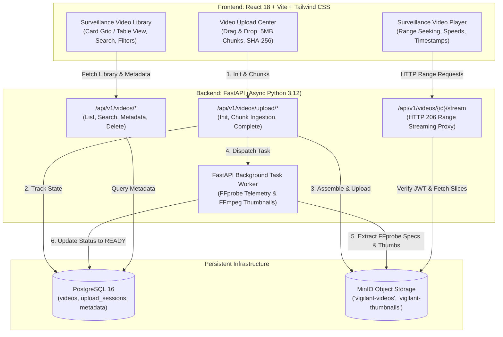

# VIGILANT Video Pipeline Architecture & Technical Specification

## 1. System Overview
VIGILANT's Video Upload, Storage, and Streaming Subsystem provides an enterprise CCTV surveillance video archive. It empowers surveillance operators and administrators to ingest high-resolution camera recordings, securely store footage in S3-compatible object storage (MinIO), automatically analyze stream telemetry via FFprobe, generate scrubbing thumbnails via FFmpeg, and stream partial-content HTTP 206 footage with full scrubbing and playback speed controls.

---

## 2. Component Specifications

### 2.1 Storage Infrastructure: MinIO Service
- **Service Name**: `minio` in `docker-compose.yml`
- **Image**: `minio/minio:RELEASE.2024-11-07T00-52-20Z`
- **Data Volume**: Persistent Docker volume `minio_data:/data`
- **Ports**:
  - `9000:9000`: S3 API Endpoint (accessible to backend on internal network `vigilant-net`)
  - `9001:9001`: MinIO Web Console
- **Default Buckets**:
  - `vigilant-videos`: Stores original uploaded CCTV video files (private)
  - `vigilant-thumbnails`: Stores extracted preview JPEG images
- **Client Integration**: Python `minio` SDK initialized at application boot with bucket auto-creation.

---

### 2.2 Database Schema (PostgreSQL 16)

#### Table `videos`
| Column | Type | Constraints | Description |
| :--- | :--- | :--- | :--- |
| `id` | UUID | PK, default uuid4 | Unique video identifier |
| `title` | VARCHAR(255) | NOT NULL | Video title or camera tag |
| `description` | TEXT | NULLABLE | Surveillance notes or location details |
| `original_filename` | VARCHAR(255) | NOT NULL | Original file name on disk |
| `file_size` | BIGINT | NOT NULL | Total size in bytes |
| `content_type` | VARCHAR(100) | NOT NULL | MIME type (e.g. `video/mp4`, `video/webm`, `video/x-matroska`) |
| `sha256_checksum` | VARCHAR(64) | NULLABLE | Full file SHA-256 hash |
| `s3_key` | VARCHAR(500) | NOT NULL | Object key in MinIO `vigilant-videos` bucket |
| `thumbnail_s3_key` | VARCHAR(500) | NULLABLE | Thumbnail key in `vigilant-thumbnails` bucket |
| `status` | VARCHAR(30) | NOT NULL, DEFAULT 'UPLOADING' | `UPLOADING`, `PROCESSING`, `READY`, `FAILED` |
| `error_message` | TEXT | NULLABLE | Processing or validation error details |
| `duration_seconds` | FLOAT | NULLABLE | Stream duration in seconds (FFprobe) |
| `width` | INTEGER | NULLABLE | Video pixel width |
| `height` | INTEGER | NULLABLE | Video pixel height |
| `fps` | FLOAT | NULLABLE | Frames per second |
| `video_codec` | VARCHAR(50) | NULLABLE | Codec (e.g., `h264`, `hevc`, `vp9`, `av1`) |
| `audio_codec` | VARCHAR(50) | NULLABLE | Audio codec (e.g., `aac`, `opus`, `pcm`) |
| `bitrate` | BIGINT | NULLABLE | Overall bitrate in bps |
| `raw_metadata` | JSONB | NULLABLE | Full parsed FFprobe metadata |
| `uploaded_by_id` | UUID | FK -> `users.id` | User who uploaded the footage |
| `created_at` | TIMESTAMPTZ | NOT NULL, DEFAULT now() | Upload creation timestamp |
| `updated_at` | TIMESTAMPTZ | NOT NULL, DEFAULT now() | Last update timestamp |

#### Table `video_upload_sessions`
| Column | Type | Constraints | Description |
| :--- | :--- | :--- | :--- |
| `id` | UUID | PK, default uuid4 | Active upload session ID |
| `video_id` | UUID | FK -> `videos.id`, ON DELETE CASCADE | Associated video entry |
| `total_chunks` | INTEGER | NOT NULL | Total expected chunks |
| `chunk_size` | INTEGER | NOT NULL | Standard chunk size (5,242,880 bytes / 5MB) |
| `uploaded_chunks` | INTEGER | NOT NULL, DEFAULT 0 | Count of received chunks |
| `expected_sha256` | VARCHAR(64) | NULLABLE | Pre-computed client SHA-256 checksum |
| `temp_directory` | VARCHAR(500) | NOT NULL | Local storage path for in-flight chunks |
| `is_completed` | BOOLEAN | NOT NULL, DEFAULT FALSE | Whether reassembly has finished |
| `created_at` | TIMESTAMPTZ | NOT NULL, DEFAULT now() | Session creation timestamp |
| `expires_at` | TIMESTAMPTZ | NOT NULL | Session expiry (e.g., 24 hours) |

#### Table `video_chunks`
| Column | Type | Constraints | Description |
| :--- | :--- | :--- | :--- |
| `id` | UUID | PK, default uuid4 | Chunk ID |
| `upload_session_id` | UUID | FK -> `video_upload_sessions.id`, ON DELETE CASCADE | Parent upload session |
| `chunk_index` | INTEGER | NOT NULL | 0-indexed chunk sequence number |
| `chunk_size` | INTEGER | NOT NULL | Byte length of this chunk |
| `sha256_checksum` | VARCHAR(64) | NOT NULL | Verified hash of this chunk |
| `received_at` | TIMESTAMPTZ | NOT NULL, DEFAULT now() | Timestamp received |

---

### 2.3 Chunked Upload & Integrity Ingestion Protocol
1. **Initialize Upload**: `POST /api/v1/videos/upload/init`
   - Request: `{ "filename": "cam1_feed.mp4", "file_size": 125829120, "content_type": "video/mp4", "chunk_size": 5242880, "total_chunks": 24, "title": "Perimeter Cam 01", "description": "Night shift recording" }`
   - Response: `{ "upload_id": "<uuid>", "video_id": "<uuid>", "chunk_size": 5242880, "total_chunks": 24, "uploaded_chunks": [] }`
2. **Chunk Ingestion**: `POST /api/v1/videos/upload/chunk`
   - Form data: `upload_id: UUID`, `chunk_index: int`, `chunk_hash: str`, `file: UploadFile`
   - Action: Validates hash matches chunk bytes; stores chunk at `/tmp/vigilant_uploads/<upload_id>/<chunk_index>.part`; records chunk in `video_chunks`.
   - Response: `{ "upload_id": "<uuid>", "chunk_index": 0, "status": "STORED", "uploaded_count": 1 }`
3. **Resumption / Status Check**: `GET /api/v1/videos/upload/{upload_id}/status`
   - Returns array of already uploaded chunk indices so client can skip them on reconnection.
4. **Complete Upload**: `POST /api/v1/videos/upload/complete`
   - Request: `{ "upload_id": "<uuid>", "expected_sha256": "optional_hex" }`
   - Action:
     - Verifies all chunks from `0` to `total_chunks - 1` are present.
     - Assembles chunks in order into complete file stream directly into MinIO `vigilant-videos` bucket.
     - Computes combined SHA-256 hash during streaming reassembly; verifies against client expectation.
     - Cleans up temporary chunk files.
     - Sets video status to `PROCESSING` in PostgreSQL.
     - Spawns background worker task for metadata and thumbnail generation.
     - Returns: `{ "video_id": "<uuid>", "status": "PROCESSING", "s3_key": "..." }`

---

### 2.4 Media Telemetry & Thumbnail Generation (FFprobe & FFmpeg)
When an upload finishes:
1. **FFprobe Execution**:
   - Command: `ffprobe -v quiet -print_format json -show_format -show_streams <temp_or_minio_stream>`
   - Extracts:
     - `duration_seconds`: parsed from `format.duration`
     - `width`, `height`: parsed from first video stream
     - `fps`: calculated from `r_frame_rate` (e.g., `30/1` -> 30.0)
     - `video_codec`: e.g., `h264`, `hevc`
     - `audio_codec`: e.g., `aac`
     - `bitrate`: parsed from `format.bit_rate`
2. **FFmpeg Thumbnail Extraction**:
   - Seeks to 10% of duration (or 1.0 second) to avoid black opening frames:
   - Command: `ffmpeg -ss <timestamp> -i <input> -vframes 1 -q:v 2 -vf "scale=640:-1" <thumbnail_output.jpg>`
   - Uploads resulting JPEG to MinIO bucket `vigilant-thumbnails` under `thumbnails/<video_id>.jpg`.
3. **Database Finalization**:
   - Updates `videos` record with extracted metadata, `thumbnail_s3_key`, and transitions status to `READY`.
   - If extraction fails, transitions status to `FAILED` and logs `error_message`.

---

### 2.5 Range-Based Streaming (HTTP 206 Partial Content)
- **Endpoint**: `GET /api/v1/videos/{video_id}/stream`
- **Headers**:
  - Request: `Range: bytes=start-end` (standard HTML5 video seeking)
  - Response:
    - Status: `206 Partial Content` (or `200 OK` if no Range header provided)
    - `Content-Range: bytes start-end/total_file_size`
    - `Accept-Ranges: bytes`
    - `Content-Length: chunk_length`
    - `Content-Type: video/mp4` (or video content type)
- **MinIO Streaming**:
  - Backend uses MinIO's `get_object(bucket, key, offset=start, length=chunk_length)` to stream byte slices without loading the entire video into memory, guaranteeing efficient RAM usage even with multi-gigabyte 4K CCTV recordings.

---

### 2.6 Thumbnail Serving Endpoint
- **Endpoint**: `GET /api/v1/videos/{video_id}/thumbnail`
- Streams the extracted JPEG image from MinIO `vigilant-thumbnails` with caching headers (`Cache-Control: public, max-age=86400`).

---

### 2.7 Frontend User Experience & Architecture
- **Tabbed Top Navigation**:
  1. `Live CCTV`: Command center with real-time stream cards, system clock, and AI readiness.
  2. `Video Archive`: Main library view with search bar, status filters (`All`, `Ready`, `Processing`, `Uploading`, `Failed`), resolution and codec tags, grid/table switcher, and pagination.
  3. `Upload Center`: Dedicated drag-and-drop zone with multi-file queue, real-time chunk progress bars, transfer speeds, ETA, pause/resume, and retry buttons.
- **Surveillance Theater Player Modal**:
  - High-precision video scrubbing timeline with current time and duration in `HH:MM:SS`.
  - Jump controls: `« 10s`, `« 5s`, `Play/Pause`, `5s »`, `10s »`.
  - Speed selector: `0.5x`, `1.0x`, `1.25x`, `1.5x`, `2.0x`.
  - Technical telemetry badge: Resolution (`1920x1080`), FPS (`30 FPS`), Codecs (`H.264 / AAC`), Bitrate (`4.2 Mbps`), and File Size.
  - Fullscreen toggle and volume slider.
  - Video download button (for authorized operators).

