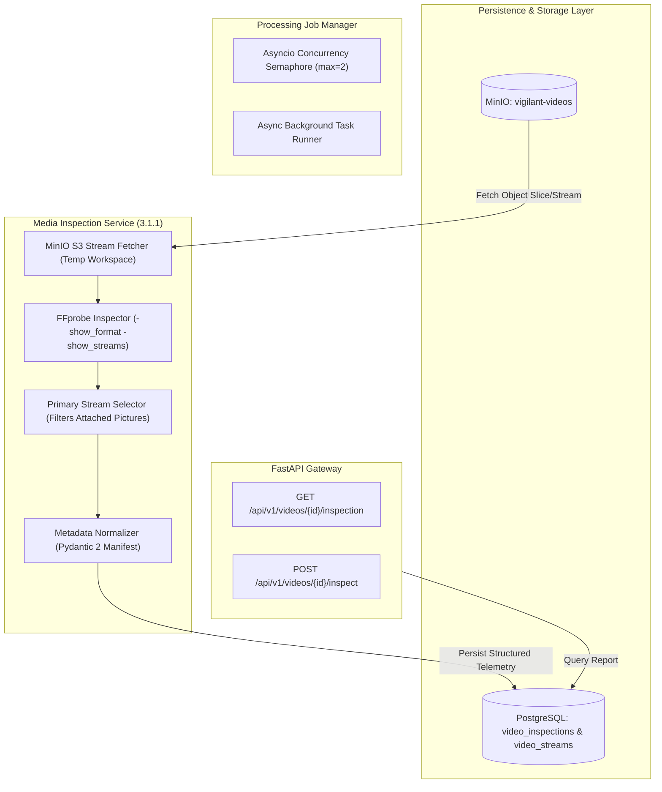
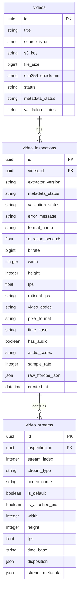

# Technical Specification: Phase 3.1.1 - FFprobe Metadata Extractor & Media Inspection

## 1. System Overview

As the initial milestone in the **Video Preprocessing** phase (Milestone 3.1.1), the **FFprobe Metadata Extractor** is responsible for extracting, analyzing, selecting, normalizing, and persisting multi-stream container and codec metadata from CCTV surveillance footage stored in MinIO object storage.



---

## 2. Information Extraction Schema (5 Categories)

The extractor dissects ingested footage across five standardized categories:

### Category A: File Information
| Field | Type | Description |
| :--- | :--- | :--- |
| `original_filename` | String | Filename as submitted during upload/recording |
| `file_size` | Integer (bytes) | Physical size in bytes |
| `file_format` | String | Container format identifier (e.g. `mov,mp4,m4a,3gp,3g2,mj2`) |
| `sha256_checksum` | String (64-char) | SHA-256 cryptographic digest verifying media integrity |
| `upload_timestamp` | DateTime (UTC) | Timestamp when footage was first registered in system |

### Category B: Container Information
| Field | Type | Description |
| :--- | :--- | :--- |
| `format_name` | String | Container format family (e.g. `mp4`, `matroska,webm`) |
| `format_long_name` | String | Full human-readable container description |
| `duration_seconds` | Float | Container-level duration in fractional seconds |
| `bitrate` | Integer (bps) | Overall container average bitrate |
| `start_time` | Float | Container start presentation timestamp |
| `container_size` | Integer (bytes) | Total byte size as reported by container header |

### Category C: Video Stream Information (Primary Stream)
| Field | Type | Description |
| :--- | :--- | :--- |
| `stream_index` | Integer | FFprobe stream index (e.g. `0`, `1`) |
| `codec_name` | String | Video codec (e.g. `h264`, `hevc`, `mjpeg`) |
| `codec_long_name` | String | Full codec designation |
| `width` | Integer | Frame width in pixels |
| `height` | Integer | Frame height in pixels |
| `fps` | Float | Evaluated average frame rate (e.g. `29.97`, `30.0`) |
| `rational_fps` | String | Exact rational frame rate (e.g. `30000/1001`, `25/1`) |
| `pixel_format` | String | Pixel representation (e.g. `yuv420p`, `nv12`, `rgb24`) |
| `time_base` | String | Stream time base (e.g. `1/90000`, `1/15360`) |
| `start_timestamp` | Float | First video frame timestamp |
| `duration_seconds` | Float | Stream-level duration |
| `reported_frame_count`| Integer (nullable) | Header-reported frame count (if present) |

### Category D: Audio Stream Information (Primary Audio)
| Field | Type | Description |
| :--- | :--- | :--- |
| `has_audio` | Boolean | True if one or more valid audio streams exist |
| `stream_index` | Integer (nullable) | Audio stream index |
| `codec_name` | String (nullable) | Audio codec (e.g. `aac`, `pcm_alaw`, `opus`) |
| `sample_rate` | Integer (nullable) | Audio sampling rate in Hz (e.g. `44100`, `48000`) |
| `channels` | Integer (nullable) | Channel count (`1` mono, `2` stereo) |
| `channel_layout` | String (nullable) | Channel layout string (e.g. `stereo`, `mono`) |
| `duration_seconds` | Float (nullable) | Audio stream duration |

### Category E: Complete Stream Disposition & Catalog
Every stream in the container is cataloged in the `video_streams` database table:
- `stream_index`: Sequential index within the container.
- `stream_type`: `video`, `audio`, `subtitle`, `data`, `attachment`.
- `codec_name`: Exact codec identifier.
- `is_default`: Flag indicating if marked as default stream (`disposition.default == 1`).
- `is_attached_pic`: Flag indicating if marked as cover art or thumbnail frame (`disposition.attached_pic == 1`).
- `disposition`: Full JSON dictionary of FFprobe stream dispositions.
- `stream_metadata`: JSON dictionary of stream tags and metadata.

---

## 3. Primary Video Stream Selection Algorithm

CCTV recordings frequently bundle multiple streams (e.g., thermal + optical, embedded cover frames, audio, telemetric subtitles). The system **must not** assume that `stream 0` is the primary video.

```
ALGORITHM: SelectPrimaryVideoStream(streams)
INPUT: List of stream descriptors from FFprobe
OUTPUT: Primary Video Stream or NULL

1. candidate_streams = []
2. FOR stream IN streams:
     IF stream.codec_type == "video":
        # Discard static cover art / thumbnail pictures
        IF stream.disposition.attached_pic == 1 OR stream.codec_name == "mjpeg" AND stream.disposition.timed_thumbnails == 1:
            CONTINUE
        APPEND stream TO candidate_streams

3. IF candidate_streams IS EMPTY:
     RETURN NULL  # No playable continuous video stream found

4. # Priority 1: Marked as explicit default stream
   default_candidates = [s FOR s IN candidate_streams IF s.disposition.default == 1]
   IF len(default_candidates) == 1:
       RETURN default_candidates[0]

5. # Priority 2: Highest pixel resolution (width * height)
   candidate_streams.SORT_BY(s => (s.width * s.height), descending=True)
   RETURN candidate_streams[0]
```

---

## 4. Metadata Extraction vs. Media Validation Separation

> [!IMPORTANT]
> **Metadata extraction is NOT media validation.**
> FFprobe successfully reading an MP4 header does **not** guarantee that later frames are uncorrupted or decodable.

The system maintains two distinct state machines:

1. **`metadata_status`**:
   - `EXTRACTING`: FFprobe subprocess actively parsing container.
   - `COMPLETED`: 5 categories normalized and written to database.
   - `FAILED`: Container unreadable, corrupted header, or process timeout.
2. **`validation_status`**:
   - `PENDING`: Initial state for all extracted footage (awaiting Milestone 3.1.2 decode validation).
   - `VALIDATED`: Complete frame-by-frame decode pass verified.
   - `INVALID`: Decoder errors or frame corruption detected.

---

## 5. Concurrency, Performance & Resource Bounds

| Constraint | Limit | Implementation |
| :--- | :--- | :--- |
| **Max Concurrent Inspections** | `2` concurrent workers | `asyncio.Semaphore(2)` in `MetadataInspectionService` |
| **FFprobe Timeout** | `120` seconds | `asyncio.wait_for(proc.communicate(), timeout=120.0)` |
| **Max Source File Size** | `10` GB | Pre-download size validation from MinIO object stats |
| **Temporary Workspace** | Local ephemeral sandbox | `/tmp/inspection_workspace/{job_id}` auto-wiped on completion |
| **Retry Strategy** | `2` retries | Exponential backoff on transient I/O network errors |

---

## 6. Database Relational Architecture


